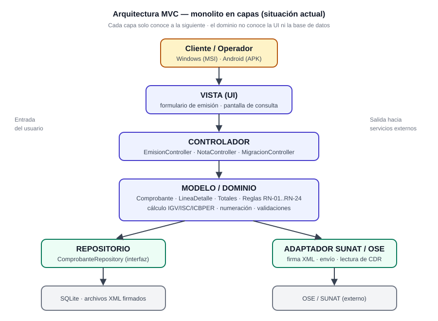
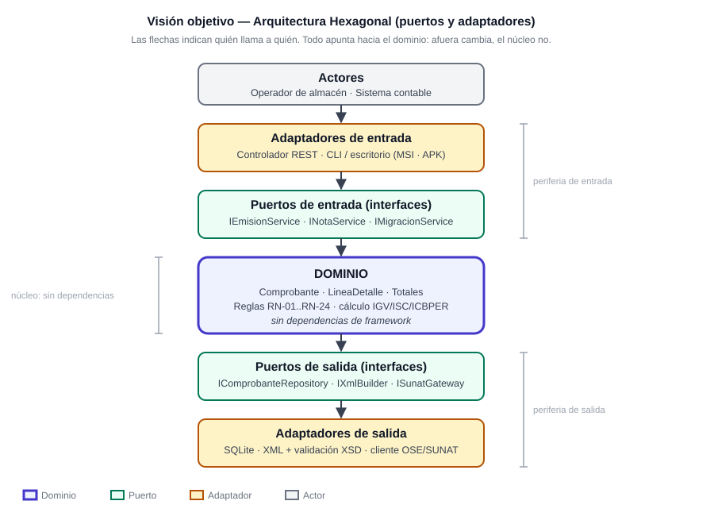
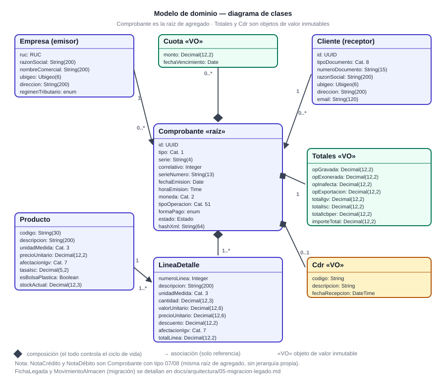

<div align="center">

# Facturación Electrónica — ABC Software Corp

**Especificaciones técnicas (Spec-First) + Taller 2: generación del XML UBL 2.1**


[](https://github.com/Joshua-A-hub/Arquitectura/actions/workflows/ci.yml)

*Arquitectura de Software · Universidad Nacional Agraria de la Selva · Grupo "A"*

**Alvarado Ichpas Benny Joshua**

</div>

> [!IMPORTANT]
> **Regla que ordena todo el diseño:** sin XML válido y firmado no existe comprobante. Ningún
> comprobante se marca como emitido si no pasó la validación formal y el CDR.

Este repositorio contiene la **especificación completa** del sistema (reglas, contratos, validaciones y
arquitectura definidos antes del código) **y la implementación de la generación del XML UBL 2.1**
(Taller 2): el dominio ejecuta las 25 reglas y un adaptador traduce el agregado a los esquemas
oficiales de OASIS. No incluye interfaz de usuario, API HTTP, firma digital ni envío a la OSE: eso
está declarado como alcance siguiente.

---

## Entregables

| # | Entregable del enunciado | Dónde está | Evidencia |
|:--:|---|---|---|
| **E1** | Modelo de Dominio y Contratos (DTOs / Schemas) | [`specs/domain/`](specs/domain/modelo-dominio.md) · [`specs/contracts/dto/`](specs/contracts/dto/) | 9 JSON Schemas validados |
| **E2** | Diagramas de Arquitectura MVC con visión a Hexagonal | [`specs/architecture/`](specs/architecture/mvc-hexagonal.md) · [`docs/arquitectura/`](docs/arquitectura/README.md) | 11 requisitos ASR + 10 RNF + 6 ADR |
| **E3** | Especificación de Endpoints / Servicios (Contratos API) | [`facturacion-api.yaml`](specs/contracts/facturacion-api.yaml) | 12 rutas · 18 esquemas · JWT |
| **E4** | Matriz de Trazabilidad Normativa SUNAT ↔ UBL | [`04-matriz`](docs/arquitectura/04-matriz-trazabilidad-normativa.md) · [`08-tabla de match`](docs/arquitectura/08-tabla-match-sunat-ubl.md) | 63 cruces + 47 campos |

📄 **Documento consolidado para entregar:** [`MEMORIA-TECNICA.docx`](MEMORIA-TECNICA.docx) ·
🔍 **Informe de verificación:** [`VERIFICACION.md`](VERIFICACION.md)

---

## Cómo se ve la arquitectura

<div align="center">




*Izquierda: monolito MVC de hoy · Derecha: visión objetivo con puertos y adaptadores*



*Modelo de dominio: `Comprobante` es la raíz de agregado; `Totales`, `Cdr` y `Cuota` son objetos de valor*

</div>

---

## Verificación

Los contratos no son documentos muertos: hay tres validadores ejecutables.

```bash
pip install -r requirements.txt
python validacion/verificar_entrega.py     # todo en uno
```

| Script | Qué comprueba | Resultado |
|---|---|---|
| [`verificar_entrega.py`](validacion/verificar_entrega.py) | integral: contratos, XML, enlaces, cifras, artefactos | **8/8** |
| [`validar_contratos.py`](validacion/validar_contratos.py) | 9 JSON Schemas, 3 ejemplos y el OpenAPI (parseo real) | **17/17** |
| [`validar_xml_ubl.py`](validacion/validar_xml_ubl.py) | XML contra XSD, totales, RUC (módulo 11) | **12/12** |

Incluyen **controles negativos** que demuestran que las pruebas sirven: quitar `serie_numero` del
ejemplo rompe la validación (código de salida 1); adulterar el IGV de cabecera rompe la reconciliación
de totales.

---

## Taller 2 (2.º parcial): generación del XML

Implementación de la **generación de XML a partir de `UBL-Invoice-2.1.xsd`**, en el lenguaje del
dominio y evaluada con **pruebas unitarias de generación**. Detalle completo en
[`docs/taller-2-generacion-xml.md`](docs/taller-2-generacion-xml.md).

```bash
pip install -r requirements-dev.txt
pytest tests/unit -q                 # 152 pruebas (119 por regla + 28 de estructura y regresión)
python -m src.cli generar-xml specs/ejemplos/emision-cli.json --salida out
```

| Pieza | Dónde |
|---|---|
| Clases generadas del XSD oficial (`xsdata`) | [`src/adaptadores/salida/ubl/generated/`](src/adaptadores/salida/ubl/generated/) |
| Adaptador dominio → UBL → XML | [`generador.py`](src/adaptadores/salida/ubl/generador.py) |
| Validador contra el esquema oficial | [`validador.py`](src/adaptadores/salida/ubl/validador.py) |
| Dominio ejecutable (catálogos, tributos, letras) | [`src/dominio/`](src/dominio/) |
| Pruebas de generación + XML de referencia | [`tests/unit/generacion_xml/`](tests/unit/generacion_xml/) |
| Regenerar clases | `scripts/generar_clases_ubl.ps1` |

Los **6 escenarios propios** —factura del contrato (F001-00000123, S/ 530.00), factura con ISC de
los tres sistemas, exportación en USD, boleta con DNI, nota de crédito por devolución y factura
migrada con vale— nacen de nuestros contratos y del maestro del caso, y **validan contra los
esquemas oficiales** de OASIS.

---

## Estructura

<details>
<summary><b>Ver el árbol completo del repositorio</b></summary>

```text
examen/
├── MEMORIA-TECNICA.docx          documento consolidado (portada + figuras)
├── VERIFICACION.md               informe: enunciado → evidencia → pruebas
├── 00-caso.md                    caso transcrito + requisitos REQ-01..REQ-12
├── 01-RESUMEN-EJECUTIVO.md       portada y mapa de entregables
├── docs/
│   ├── SDD_WORKFLOW.md           ciclo Spec-First
│   ├── benchmark-facturacion.md  dolores de usuarios → decisiones
│   └── arquitectura/
│       ├── README.md             lectura de los diagramas
│       ├── 01-mvc-capas.svg/.png
│       ├── 02-hexagonal.svg/.png
│       ├── 03-secuencia-emision.md
│       ├── 04-matriz-trazabilidad-normativa.md    E4
│       ├── 05-migracion-legado.md
│       ├── 06-distribucion-msi-apk.md
│       ├── 07-diagrama-clases.svg/.png            E1
│       └── 08-tabla-match-sunat-ubl.md            match por campo
├── specs/
│   ├── README.md                 reglas de la carpeta
│   ├── adr/                      0001 MVC→Hexagonal · 0002 UBL/XSD · 0003 multiplataforma · 0004 IXmlBuilder · 0005 Decimal · 0006 outbox
│   ├── architecture/             mvc-hexagonal (ASR + RNF)
│   ├── contracts/                OpenAPI + dto/ + catalogs/ + ubl/ (con XSD)
│   ├── domain/                   modelo-dominio · reglas-negocio · marco-normativo
│   ├── features/                 casos de uso (Gherkin)
│   └── templates/                plantillas de spec, ADR y contrato
├── src/
│   ├── domain/                   dominio ejecutable: catálogos, tributos, letras, comprobante
│   ├── adapters/outbound/ubl/    generador (xsdata) + validador + clases del XSD oficial
│   ├── cli.py                    segundo adaptador de entrada (generar-xml)
│   └── puertos.py                interfaces del hexágono
├── tests/
│   ├── unit/generacion_xml/      115 pruebas de generación + esperados/*.xml
│   ├── unit/test_dominio.py      44 pruebas de dominio
│   └── mocks/mock_db.py          datos de prueba
├── scripts/                      regeneración de las clases desde el XSD
├── validacion/                   los tres validadores
└── requirements-dev.txt          pytest + xsdata + lxml (Taller 2)
```

</details>

---

## Trazabilidad al enunciado

<details>
<summary><b>Ver cada exigencia del examen y dónde se cubre</b></summary>

| El examen pide… | Dónde está |
|---|---|
| *"El Modelo de Dominio y Contratos (DTOs / Schemas)"* | [`specs/domain`](specs/domain/modelo-dominio.md) · [`specs/contracts/dto`](specs/contracts/dto/) |
| *"Diagramas de Arquitectura MVC con visión a Hexagonal"* | [`specs/architecture`](specs/architecture/mvc-hexagonal.md) · [`docs/arquitectura`](docs/arquitectura/README.md) |
| *"Especificación de Endpoints / Servicios (Contratos API)"* | [`facturacion-api.yaml`](specs/contracts/facturacion-api.yaml) |
| *"Matriz de Trazabilidad Normativa con cruces entre datos SUNAT y datos UBL"* | [`04-matriz`](docs/arquitectura/04-matriz-trazabilidad-normativa.md) · [`08-tabla de match`](docs/arquitectura/08-tabla-match-sunat-ubl.md) |
| *"Legado y Migración de Datos … sin perder trazabilidad"* | [`05-migracion`](docs/arquitectura/05-migracion-legado.md) · RN-21..RN-24 |
| *"Normativa Tributaria Peruana … el catálogo 8 de SUNAT"* | [`catalogos`](specs/contracts/catalogs/catalogos-sunat.md) · [`marco normativo`](specs/domain/marco-normativo.md) — *el "catálogo 8" del enunciado: **06** es identidad y **08** el sistema de cálculo del ISC* |
| *"monolítica limpia … MVC … Arquitectura Hexagonal o Clean"* | [`mvc-hexagonal`](specs/architecture/mvc-hexagonal.md) · [ADR-0001](specs/adr/0001-monolito-mvc-con-vision-hexagonal.md) |
| *"Windows … Android … instalador MSI … APK"* | [`06-distribucion`](docs/arquitectura/06-distribucion-msi-apk.md) · [ADR-0003](specs/adr/0003-estrategia-multiplataforma.md) |
| *"detalle los casos posibles … Nubefact"* | [`casos de uso`](specs/features/casos-de-uso.md) · [`benchmark`](docs/benchmark-facturacion.md) |
| *"estudiando el archivo UBL-Invoice-2.1.xsd"* | [`perfil UBL`](specs/contracts/ubl/perfil-invoice.md) · [`XSD oficiales`](specs/contracts/ubl/oficial/) |

</details>

---

## Alcance

| ✅ Incluye | ❌ No incluye |
|---|---|
| Especificación completa (E1–E4) | Interfaz de usuario (pantallas o wireframes) |
| Dominio ejecutable: 25 reglas, IGV/ISC/ICBPER, RUC, letras | API HTTP implementada |
| **Generación del XML** con clases del XSD oficial (Taller 2) | Firma digital XMLDSig |
| Validador contra el esquema oficial y CLI | Envío real a SUNAT/OSE y CDR |
| 6 ADR, 152 pruebas unitarias y CI | Libros PLE en formato Anexo 2 |
| Matriz normativa y tabla de match | Empaquetado MSI/APK (decisión documentada) |

> La **interfaz de usuario no forma parte de la entrega**: el contrato API es un contrato de servicio y
> la restricción MSI/APK se documenta como restricción arquitectónica (ADR-0003).

---

## Decisiones que se pueden defender

1. **El contrato manda.** El OpenAPI y los 9 JSON Schemas se escribieron antes que cualquier
   implementación, y el validador comprueba que siguen siendo coherentes.
2. **Un mock, una fuente.** Los datos de prueba viven solo en `tests/mocks/`; no hay copias en `src/`.
3. **Antifraude en los datos.** El DTO de entrada no acepta `totales`, `id`, `estado` ni
   `serie_numero`: el dominio los calcula y los asigna.
4. **El dominio no conoce el framework.** Se verifica con `grep` sobre `src/dominio`; los 5 puertos de
   salida son la frontera.
5. **La validación formal va antes de guardar.** Si el XSD rechaza el XML, no se registra nada.

---

## Documentación

| Documento | Para qué |
|---|---|
| [`00-caso.md`](00-caso.md) | Caso transcrito y requisitos REQ-01..REQ-12 |
| [`01-RESUMEN-EJECUTIVO.md`](01-RESUMEN-EJECUTIVO.md) | Portada y mapa de la entrega |
| [`VERIFICACION.md`](VERIFICACION.md) | Enunciado → evidencia, pruebas y límites |
| [`MEMORIA-TECNICA.docx`](MEMORIA-TECNICA.docx) | Versión consolidada para imprimir |
| [`docs/arquitectura/`](docs/arquitectura/README.md) | Figuras, matriz y documentos de diseño |
| [`specs/`](specs/README.md) | Fuente de verdad: dominio, contratos y ADR |

---

<div align="center">

**Trabajo académico** — Universidad Nacional Agraria de la Selva · Arquitectura de Software · 2026

**Alvarado Ichpas Benny Joshua**

*Estado: especificaciones (1.er parcial) + generación del XML (Taller 2). Los límites conocidos están
declarados en [`VERIFICACION.md §4`](VERIFICACION.md).*

</div>
