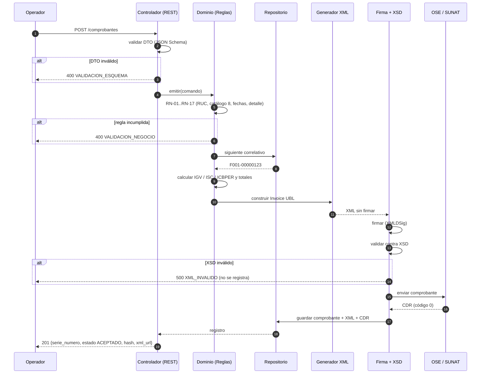

# Flujo de emisión — secuencia

Complementa los diagramas de arquitectura. Muestra **quién llama a quién** y **dónde se corta** el
proceso cuando algo no cumple.

## Lectura en palabras

1. **Nada se guarda** hasta que el XML valida. El orden es la garantía: primero se comprueba, después
   se persiste.
2. El **correlativo** se asigna dentro de la transacción: si la emisión falla, no se consume.
3. La **firma** ocurre antes de la validación XSD, y el perfil **admite** el bloque de extensión
   (`ext:UBLExtensions`) donde viaja la firma; validar la firma en sí es trabajo de fase 2.
4. El **CDR** se almacena junto al XML: es la evidencia de que SUNAT aceptó el documento.
5. Un fallo de red **no reemite**: deja el comprobante en `PENDIENTE_ENVIO` (RN-20).
