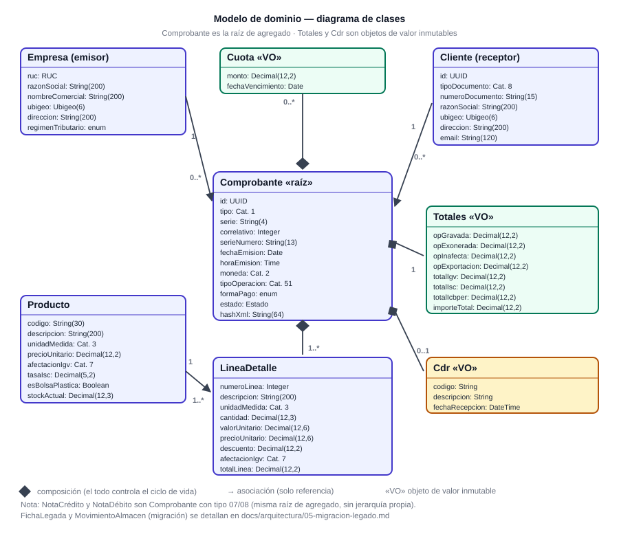
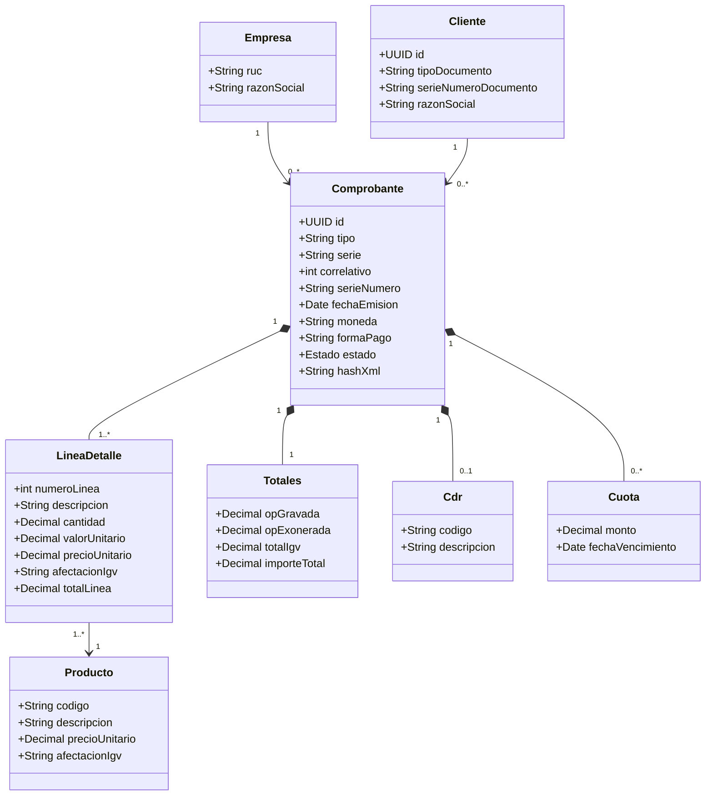

# Diagrama de clases del dominio

**Entregable E1 (vista estructural).** Complementa a
[`specs/domain/modelo-dominio.md`](../../specs/domain/modelo-dominio.md): allí están las reglas y los
campos; aquí, la **estructura visual** de las clases, sus tipos y sus relaciones.



---

## 1. Lectura del diagrama

| Relación | Significado | Ejemplo |
|---|---|---|
| ◆ **Composición** | El todo controla el ciclo de vida de la parte; la parte no existe sola | `Comprobante ◆── LineaDetalle` |
| → **Asociación** | Solo referencia por identificador | `LineaDetalle ──> Producto` |
| «VO» | Objeto de valor: inmutable, se compara por contenido | `Totales`, `Cdr`, `Cuota` |

## 2. Multiplicidades y su porqué

| Relación | Multiplicidad | Justificación |
|---|---|---|
| Empresa → Comprobante | `1 → 0..*` | un emisor emite muchos comprobantes; el emisor sale del contexto, no del body |
| Cliente → Comprobante | `1 → 0..*` | un cliente acumula comprobantes |
| Comprobante ◆→ LineaDetalle | `1 → 1..*` | no hay comprobante sin al menos una línea (RN-14) |
| Comprobante ◆→ Totales | `1 → 1` | los totales se calculan, nunca se reciben (RN-09) |
| Comprobante ◆→ Cuota | `1 → 0..*` | solo si la forma de pago es `CREDITO` (RN-09) |
| Comprobante ◆→ Cdr | `1 → 0..1` | existe desde que SUNAT responde (RN-19) |
| LineaDetalle → Producto | `1..* → 1` | la línea referencia el producto por código |
| Producto → LineaDetalle | `1 → 1..*` | un producto aparece en muchas ventas |

## 3. Decisiones de modelado (defendibles en la defensa)

1. **`Comprobante` es la raíz de agregado.** Las líneas, los totales, las cuotas y el CDR no se
   acceden ni se modifican por fuera: se cambian a través del comprobante. Eso es lo que hace posible
   la regla de inmutabilidad (INV-01).
2. **Notas de crédito y débito no son jerarquía.** Se modelan como `Comprobante` con `tipo 07/08`. La
   diferencia está en el tipo y en la referencia al original (RN-16), no en la estructura. Una
   jerarquía agregaría clases sin agregar comportamiento distinto.
3. **`Totales` es un objeto de valor.** No tiene identidad propia y se reemplaza completo: evita el
   bug clásico de "actualicé un total y no el otro".
4. **`Producto` es agregado independiente** porque tiene su propio ciclo de vida (stock).
5. **`FichaLegada` no es parte del dominio tributario**: es el agregado de migración y se detalla en
   [`05-migracion-legado.md`](05-migracion-legado.md).

## 4. Correspondencia con los DTOs

| Clase de dominio | DTO expuesto | Nota |
|---|---|---|
| `Comprobante` | `ComprobanteCreate` (entrada) / `ComprobanteResponse` (salida) | el DTO de entrada **no** tiene `id`, `estado`, `hash` ni `cdr` |
| `Cliente` | `ClienteRef` (dentro del comprobante) y `Cliente` (maestro) | el maestro agrega `id` y `email` |
| `Producto` | `Producto` | — |
| `LineaDetalle` | `LineaDetalle` | en el DTO no viajan `valorUnitario`, `igvLinea` ni `totalLinea`: son calculados |
| `Totales` | `Totales` (solo en la respuesta) | nunca en la petición (protección RN-09) |

## 5. Código equivalente (fase 2)

El diagrama se traduce a `src/dominio/`:

```text
src/dominio/comprobante.py      Comprobante, LineaDetalle (entidades y agregado)
src/dominio/valores.py          Totales, Cdr, Cuota (objetos de valor)
src/dominio/calculadora.py      cálculo de IGV, ISC, ICBPER (RN-04..RN-09)
```

> En la fase 1 estas clases **no existen como código**: existen como especificación. Ver
> [`src/README.md`](../../src/README.md).

## 6. Diagrama en Mermaid (para quien lo renderice)


