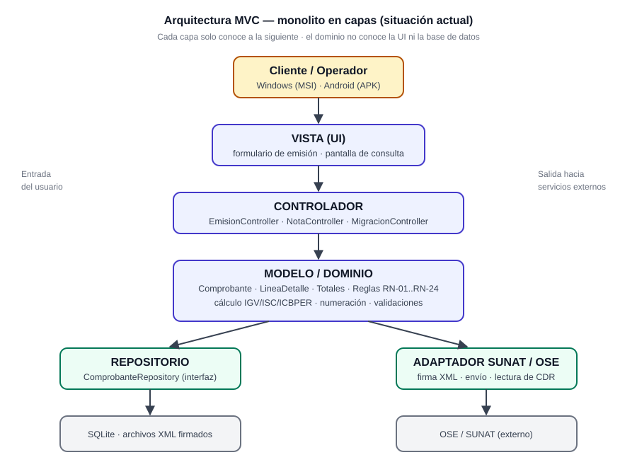
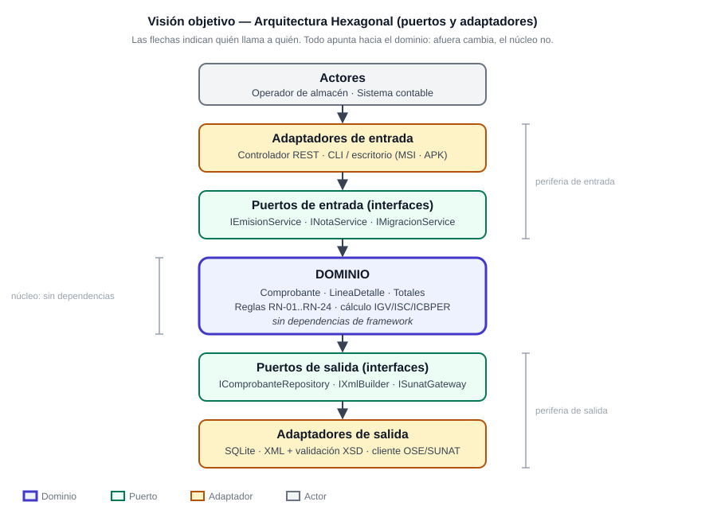

# Entregable E2 — Diagramas de arquitectura

**Requisito del examen:** *"Diagramas de Arquitectura MVC con visión a Hexagonal."*

Dos vistas, dos momentos: **hoy** (monolito MVC) y **objetivo** (hexagonal), con el camino entre
ambas. Los `.svg` abren en cualquier navegador, se insertan en Word y se imprimen sin perder nitidez.

| Vista | Archivo | Pregunta que responde |
|---|---|---|
| MVC en capas (situación actual) | [`01-mvc-capas.svg`](01-mvc-capas.svg) · [PNG](01-mvc-capas.png) | ¿Cómo está organizado el monolito hoy? |
| Hexagonal (visión objetivo) | [`02-hexagonal.svg`](02-hexagonal.svg) · [PNG](02-hexagonal.png) | ¿Cómo queda desacoplado para escalar? |
| Flujo de emisión | [`03-secuencia-emision.md`](03-secuencia-emision.md) | ¿Qué pasa paso a paso al emitir? |
| Matriz de trazabilidad (E4) | [`04-matriz-trazabilidad-normativa.md`](04-matriz-trazabilidad-normativa.md) | ¿Qué dato SUNAT va en qué etiqueta UBL? |
| Tabla de match campo a campo | [`08-tabla-match-sunat-ubl.md`](08-tabla-match-sunat-ubl.md) | ¿Cómo se llama cada campo en SUNAT y dónde va en el UBL? |
| Migración del legado | [`05-migracion-legado.md`](05-migracion-legado.md) | ¿Cómo se reconstruyen las fichas viejas? |
| Distribución MSI/APK | [`06-distribucion-msi-apk.md`](06-distribucion-msi-apk.md) | ¿Cómo corre en Windows y Android? |
| Diagrama de clases (E1) | [`07-diagrama-clases.md`](07-diagrama-clases.md) · [SVG](07-diagrama-clases.svg) · [PNG](07-diagrama-clases.png) | ¿Cómo se relacionan las entidades? |
| Benchmark de usuarios | [`../benchmark-facturacion.md`](../benchmark-facturacion.md) | ¿Qué dolores reales resuelve el diseño? |

> Cada figura existe en **SVG** (vectorial, ideal para imprimir) y en **PNG** (por si el visor no
> renderiza SVG).





---

## 1. Lectura del diagrama MVC

| Capa | Contiene | No puede contener |
|---|---|---|
| **Vista** | Formularios, pantallas, validación de UI | Reglas tributarias, SQL |
| **Controlador** | Recibir la petición, orquestar, decidir códigos HTTP | Cálculo de IGV, acceso a datos |
| **Modelo / Dominio** | Entidades, reglas RN-01..RN-24, cálculo de tributos, numeración | Referencias a la UI o al framework web |
| **Repositorio** | Interfaz de persistencia | Reglas de negocio |
| **Adaptador SUNAT** | Firma, envío y lectura de CDR | Cálculo de totales |

**Regla de dependencia:** cada capa solo importa a la inmediatamente inferior. La flecha jamás sube.

## 2. Lectura del diagrama hexagonal

| Elemento | Qué es | Ejemplo concreto |
|---|---|---|
| **Dominio** | El negocio puro: entidades + reglas | `Comprobante`, `calcular_totales()` |
| **Puerto** | Una **interfaz** que el dominio declara | `IComprobanteRepository`, `ISunatGateway` |
| **Adaptador** | La implementación concreta y reemplazable | `SqliteComprobanteRepository`, `OseSunatGateway` |

Los puertos ya están declarados en [`src/puertos.py`](../../src/puertos.py) (fase 1: interfaces, sin
lógica). Los adaptadores se implementan en la fase 2.

## 3. Tabla de equivalencia MVC ↔ Hexagonal

Es la evidencia de que el monolito actual **ya está preparado** para la migración: cada capa MVC tiene
su lugar en el hexágono.

| Capa MVC actual | Elemento hexagonal | Acción para migrar |
|---|---|---|
| Vista | Adaptador de entrada (UI) | Se mueve fuera del núcleo, sin cambios |
| Controlador | Adaptador de entrada (REST) | Depende de una interfaz, no de la clase concreta |
| Modelo (entidades) | **Dominio** | Se queda igual (ya no depende de nadie) |
| Servicios de cálculo | **Dominio** (servicios de dominio) | Se extraen de los controladores |
| Repositorio | **Puerto de salida** + adaptador | Se convierte en interfaz + implementación SQLite |
| Llamadas a SUNAT | **Puerto de salida** `ISunatGateway` + adaptador | Se aísla el cliente HTTP y la firma |

## 4. Dónde vive cada cosa en el repositorio

```text
src/puertos.py          → las interfaces (puertos de entrada y salida)
src/dominio/            → fase 2: entidades y reglas (núcleo, sin framework)
src/controladores/      → fase 2: capa controlador del MVC
src/adaptadores/        → fase 2: implementaciones concretas
src/vistas/             → fase 2: API REST y CLI (MSI/APK)
tests/                  → pruebas por nivel (ver tests/README.md)
```

## 5. Plan de migración en 4 pasos (sin reescribir)

1. **Extraer interfaces** de repositorio y de SUNAT (puertos) manteniendo las clases actuales como
   implementaciones. *(hecho en esta fase: `src/puertos.py`)*
2. **Mover las reglas** de los controladores a servicios de dominio puros (sin `import` de framework).
3. **Invertir dependencias**: los controladores reciben las interfaces por constructor.
4. **Separar el despliegue** cuando haga falta: el mismo dominio se empaqueta como servicio propio
   (microservicio de emisión) sin tocar las reglas.

> Criterio de verificación: si `grep -r "import fastapi" src/dominio` devuelve algo, la migración
> está incompleta.
